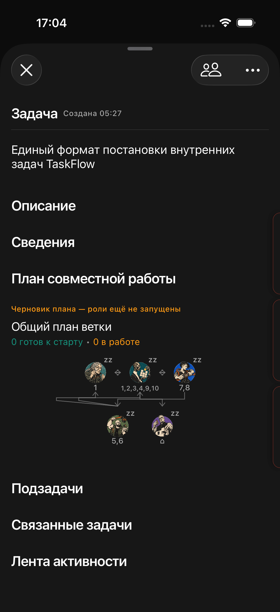
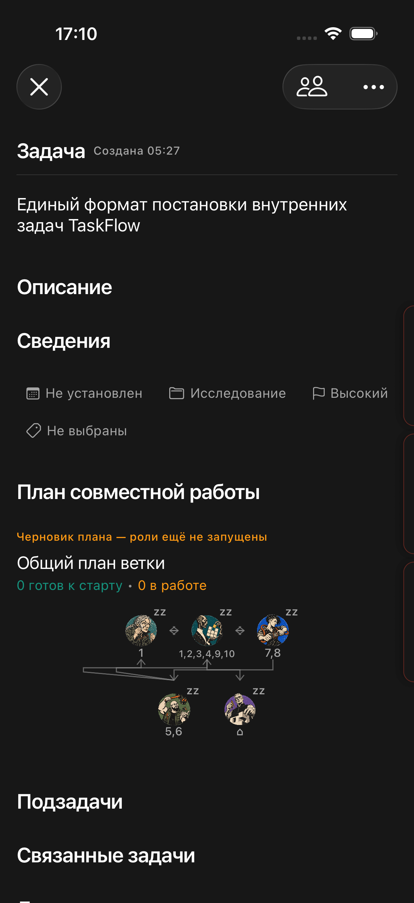

# Стабильность раскрытия карточки и графа — 03.10.2026

## Причина и исправление
Скрытый загрузчик и раскрытый граф имели отдельное состояние. Первый показ графа заново запрашивал план и подзадачи, заменяя пустую область загруженным содержимым. Повторные onAppear/task также запускали запросы. При возврате в карточку состояние графа создавалось заново.

CollaborationPlanState теперь принадлежит модели карточки и разделяется загрузчиком и графом. Повторные входы используют уже загруженный снимок. Периодическое обновление и явное обновление после действий сохранены; одинаковые ответы не меняют наблюдаемое состояние. Ошибка получения плана сохраняет последний видимый снимок.

При смене системного размера листа убрана дополнительная SwiftUI-анимация всей раскладки. Неизменившаяся нумерация семейства также не записывается повторно. Сохранённые раскрытые разделы не сбрасываются.

## Проверка
Локальный HTTP fixture с реальным снимком ветки: 11 карточек, 5 участников. Ответ плана задержан на 0,6 секунды. iOS Simulator, тот же сценарий и данные до/после.

| Измерение первого раскрытия | До | После |
|---|---:|---:|
| Дополнительные запросы плана | 2 | 0 |
| Смещение заголовка «Подзадачи» после загрузки | 195,67 pt | 0 pt |

Исходные координаты: до 479,67 → 675,33 pt; после 675,33 → 675,33 pt.

- 4 модельных теста прошли: кеш, явное обновление и сохранение данных при ошибке, совместные запросы, отсутствие инвалидирования при неизменившемся опросе.
- 2 сценария XCUITest прошли: первое раскрытие/повторное расширение листа; вытягивание дочерней карточки и возврат с сохранённым открытым графом и сведениями.
- Первые две попытки сценария возврата неверно использовали tap/короткий swipe по закладке. Финальный тест использует drag от найденного accessibility-элемента через ширину экрана. Код жеста не изменён.
- Подписанная generic iPhone-сборка: BUILD SUCCEEDED, codesign --verify --deep --strict прошёл.
- Обновлён build_device/TaskFlow.ipa. Временный UI-тест удалён после проверки; модельные тесты сохранены.

Результаты: /tmp/taskflow-layout-unit.xcresult; /tmp/taskflow-layout-final-ui.xcresult (первый сценарий); /tmp/taskflow-layout-return-drag-ui.xcresult (возврат). Из-за неверной навигации второго сценария общий final-ui bundle помечен failed; первый сценарий в нём passed.

## Границы подтверждения
Animation Hitches не поддерживается на этом симуляторе. Проверены расположение элементов и сохранение открытых секций, а не частота кадров на физическом iPhone. Окончательная плавность на устройстве требует проверки новой сборки. Сервер не менялся и не переустанавливался.

