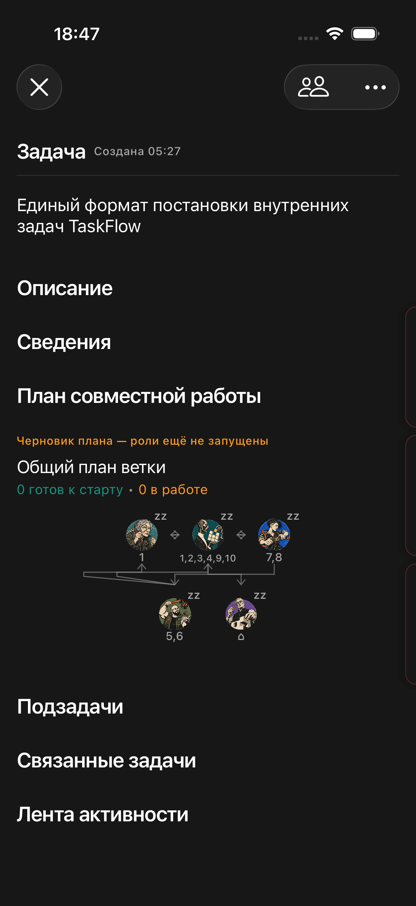
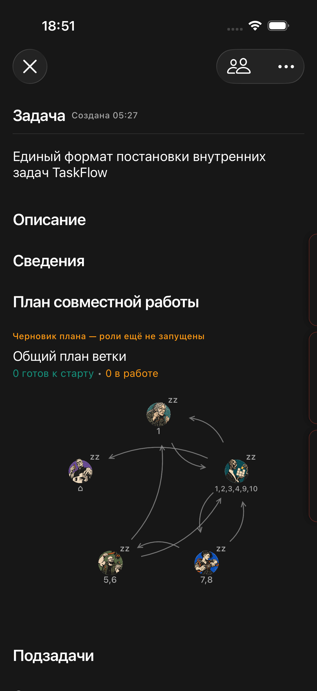

# Маршруты стрелок общего графа

03.10.2026. Исправлена визуализация агрегированной команды ветки. До изменения участники шли рядами по три, несколько ортогональных маршрутов совпадали, встречные связи одного уровня ложились друг на друга.

Участники теперь размещаются по окружности, связи рисуются отдельными направленными квадратичными дугами. Встречные связи огибают соединение с разных сторон. Концы отнесены на 40 pt от центра участника, чтобы не задевать аватарку и подпись номера; наконечник следует касательной. Совпадающих общих горизонтальных коллекторов больше нет. В плотном графе отдельные пересечения дуг остаются; это не обещание полного отсутствия пересечений.

Размеры узлов и аватарок, цвета, номера карточек, данные зависимостей и панель по нажатию сохранены. Новый маршрут применяется к общему графу участников; последовательные графы отдельных этапов сохраняют уровневую раскладку.

## Проверка
Локальный fixture с реальным снимком ветки «Единый формат постановки внутренних задач TaskFlow», 5 участников. XCUITest раскрытия графа и открытия заданий Исследователя PASS (/tmp/taskflow-graph-routes-ports.xcresult). Исходный тест ошибочно искал «Готово» в панели участника; исправлен на существующий participant-slot accessibility ID. Исходный кадр сохранён до изменения.

Подписанная iPhone-сборка BUILD SUCCEEDED; codesign --verify --deep --strict PASS. build_device/TaskFlow.ipa обновлён. Временный UI-тест удалён. Сервер и производственные планы не менялись. Приёмка на физическом iPhone остаётся владельцу.

