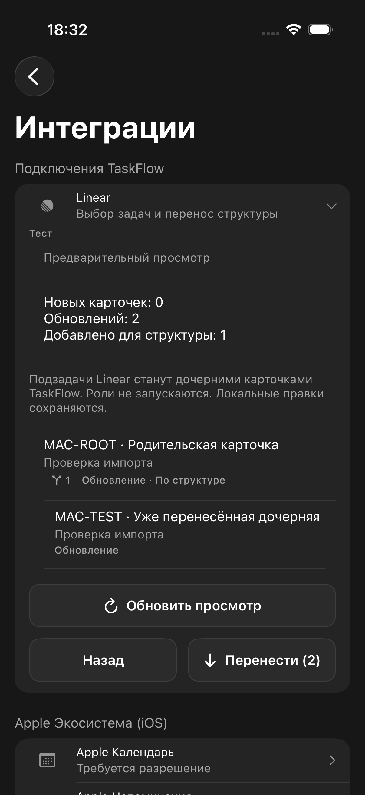
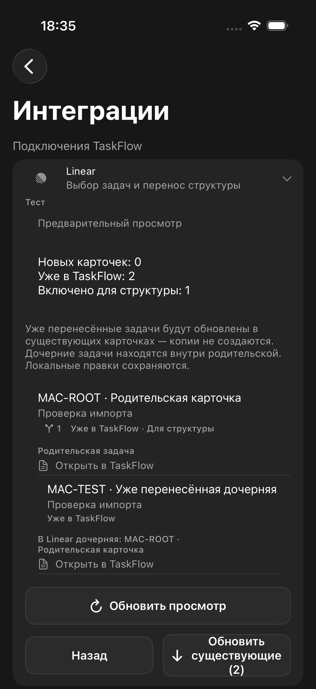
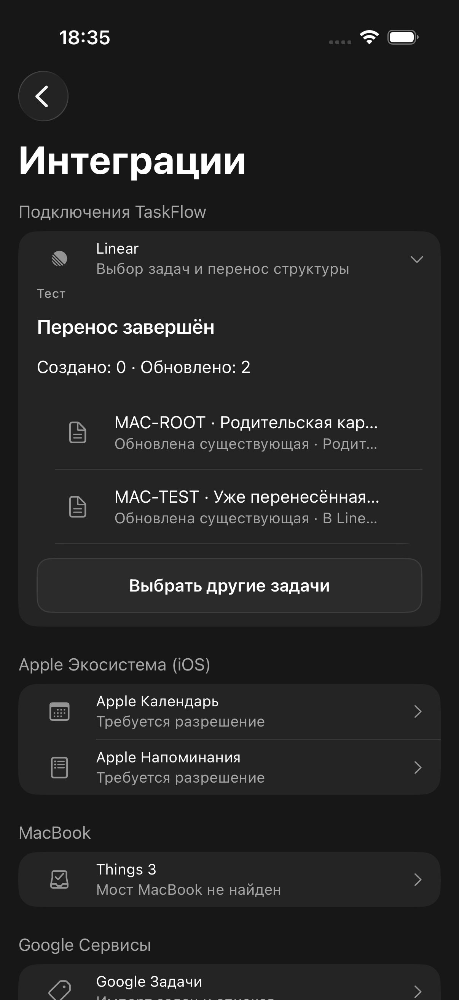

# Понятный повторный импорт Linear

03.10.2026. Предпросмотр теперь явно показывает «Уже в TaskFlow» и ссылку на существующую карточку. Указаны роль в дереве и номер/название родителя в Linear. Подпись «В Linear дочерняя» намеренная: локальная структура может сохраняться при конфликте или начатой работе.

Нулевое число новых карточек меняет подтверждение на «Обновить существующие». Смешанный перенос явно разделяет создание и обновление. После переноса сохраняются номера Linear и подписи «Создана»/«Обновлена существующая», строки открывают карточку TaskFlow без дополнительных шевронов.

Серверный контракт не менялся: идентичность определяется owner/workspace/source ID в linear_import_tasks, повторный перенос обновляет связанную карточку. Эта правка не вводит автоматическое сравнение задач по похожим названиям и не исключает обновление содержимого. Предпросмотр обязателен до подтверждения.

## Проверка
- Воспроизведено на локальном HTTP fixture: родитель и дочерняя уже перенесены, новых карточек 0. До изменения кнопка «Перенести» скрывала смысл операции.
- XCUITest после: ссылка на существующую карточку, номер родителя, подтверждение обновления, результат без нового создания — PASS.
- 5 LinearImportTests PASS, включая сохранение просмотренных данных для подписей результата.
- iPhone BUILD SUCCEEDED; codesign --verify --deep --strict PASS. build_device/TaskFlow.ipa обновлён.
- Боевая база не изменялась; импорт в UI-тесте выполнялся только на локальном fixture. Сервер не переустанавливался.
- Результаты: /tmp/taskflow-linear-clarity-before.xcresult; /tmp/taskflow-linear-clarity-final.xcresult. Временный UI-тест удалён после проверки.

