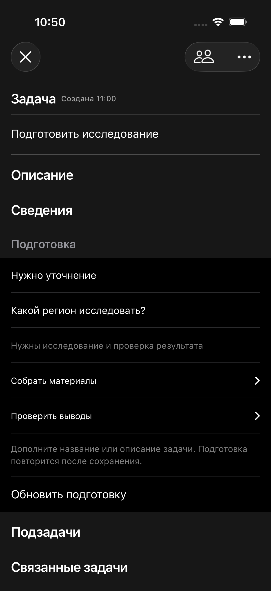
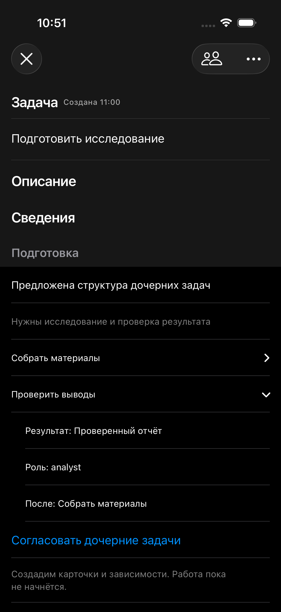

# Согласование подготовки — этап 5

03.10.2026. Локальная реализация; live сервер .110 и устройство владельца не менялись.

## Что видит владелец

Блок «Подготовка» в карточке: очередь и процесс анализа, вопрос при недостатке данных, причина выбранной структуры, раскрываемые результаты, роли и зависимости. Названия ролей берутся из каталога. Ошибка загрузки имеет повтор, ошибка анализа — повтор подготовки.

Для готового черновика есть «Согласовать и запустить план» с системным подтверждением. Это существующий approve: обязательные процессные подзадачи создаются обычным механизмом и корневые узлы запускаются. При approved кнопка скрыта, показано «План согласован».

Для самостоятельных результатов есть «Согласовать дочерние задачи» с подтверждением. Карточки создаются без запуска работы. Повтор сохраняет те же идентификаторы. Зависимости сохраняются в task_dependencies с policy=completed; предполагаемый порядок показан до согласования. Каждая новая карточка далее проходит собственную подготовку. При неотвеченном вопросе согласование структуры недоступно. Подтверждение удерживает идентификатор плана/версию предложения, открытые владельцем, а не подставляет новый вариант после фонового обновления.

Ручные шаблоны и редактор графа сохранены. Блок опрашивает состояние раз в три секунды, перечитывает карточку и граф при изменении. Ручной ввод в названии/описании не перезаписывается тихим refresh. На старом сервере 404 нового маршрута скрывает блок.

## Контракт сервера

GET /api/tasks/:id/preparation дополнен plan_status. Клиент разрешает запуск только при ready и draft.

POST /api/tasks/:id/preparation/approve-structure, тело {input_version: integer}: доступ только владельцу, проверка последней версии, снимка входа, ручного/рабочего состояния и отсутствия уже заданных детей. Создание карточек, зависимостей, событий task_created и фиксация approved_children выполнены одной транзакцией. После commit рассылаются task:updated. Ошибка состояния возвращает 409; чужая роль — 403.

## Проверка

Полный серверный прогон: 115 файлов, 836 тестов PASS. После финальных изменений событий и проверки прав: 13 профильных тестов PASS. tsc и diff check PASS.

Нативная сборка PASS; модельные тесты 2 PASS. Визуальная проверка через временный XCUITest и изолированную HTTP-фикстуру, без реальной модели и пользовательских карточек: 1 XCUITest PASS, TEST SUCCEEDED. Проверены вопрос и отсутствие согласования, независимое раскрытие результата без вызова подтверждения, создание структуры и исчезновение кнопки, запуск плана и исчезновение кнопки. Итоговый bundle: /tmp/taskflow-preparation-ui-proof.xcresult. Кадры просмотрены; фикстура остановлена, временный UI-тест удалён.

## Границы

Это локальные API/UI проверки. Реальная генерация, очередь .110, live согласование и работа агентов ещё требуют этапа 7. Применение живого графа и согласованность чатов — этап 6. Согласование дочерней структуры само по себе не утверждает планы её детей.

Интерактивные элементы размещены отдельными строками Section: общий VStack в List объединял реакции кнопок. Это проверено дополнительными отрицательными UI-утверждениями.

Дальнейшая проверка этапа 6: допуск командных планов по межкарточным зависимостям и альтернативным действиям меню. Здесь проверено сохранение зависимостей и отсутствие автоматического исполнения после создания детей, а не полный runtime-проход дерева.
