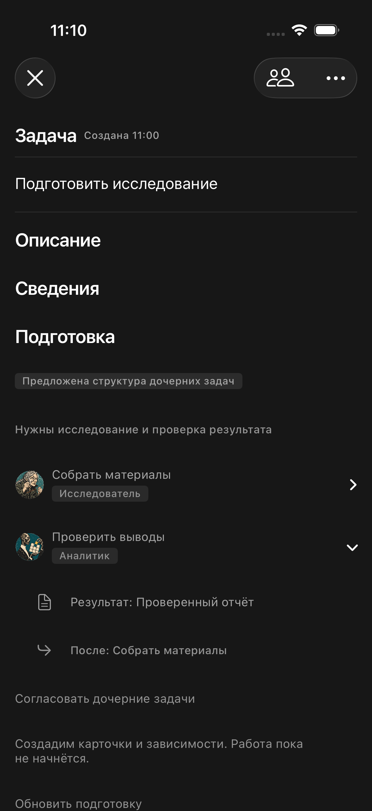

# Подготовка: оформление карточки и визуальные роли

03.10.2026. По указанию владельца блок приведён к соседним секциям TaskFormScreen, без новой типографической шкалы.

- Заголовок: taskSectionHeader — tfText(.taskTitle), 20 pt, semibold, tfText.
- Основной текст и действия: tfText(.action), 13 pt; содержимое tfSub, акцент управляющих элементов tfDim.
- Причина и зависимости: tfText(.meta), 12 pt, tfDim.
- Все строки: tfBackground, скрытые разделители — как в collapsibleSection карточки. Системные чёрные фоны и синий tint устранены.
- Роли: существующий TFAvatar размера lg, тот же role_<key>, что в графе плана; название роли в TFPill. Состояние подготовки — нейтральный TFPill. Документ результата и зависимость обозначены системными значками.

Интерактивные элементы остаются отдельными строками: раскрытие результата не вызывает согласование. Названия ролей берутся из каталога; технический ключ остаётся запасным значением при недоступном каталоге.

Временный XCUITest использует изолированную HTTP-фикстуру. Сборка и 1 XCUITest PASS (TEST SUCCEEDED), diff check PASS. Проверены раскрытие зависимости и отсутствие случайного окна согласования. Кадр просмотрен. Bundle: /tmp/taskflow-preparation-style-colors.xcresult. Временный тест удалён, фикстура остановлена. Live сервер и устройство владельца не менялись.

