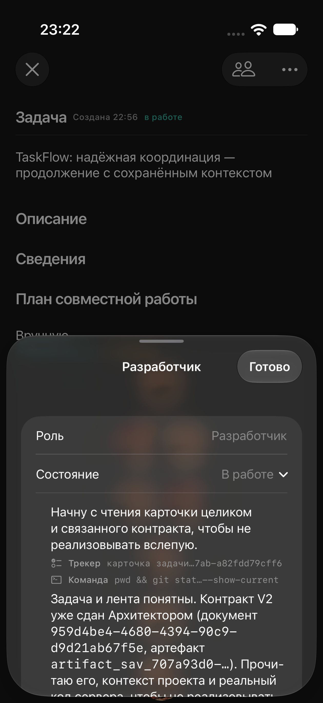
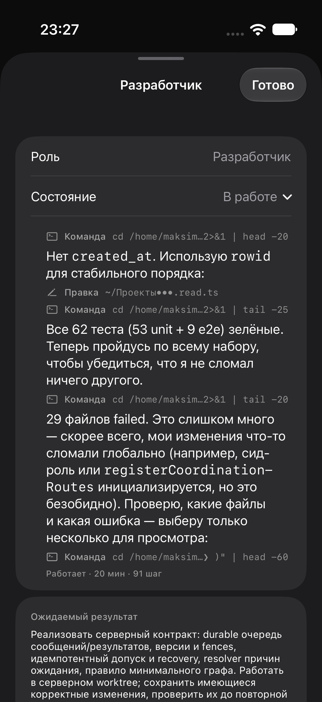

# Окно работы роли: ограничение высоты и отсутствие повторного проигрывания

## Результат
В раскрытом состоянии «В работе» после тапа по аватару история ограничена половиной высоты дисплея. Нативный ScrollView прокручивает её внутри окна, при открытии показывает последние события. В карточке накопленный снимок выводится целиком сразу, без постепенного проигрывания старого текста. Новые серверные события продолжают поступать через существующие WebSocket/REST. Эффект вывода текста в чате сохранён.

## Проверка
iPhone Air, iOS 27.0, симулятор. Временный XCUITest на живой карточке 3161afe9-9461-4020-b7ab-a82fdd79cff6: высота окна 50% дисплея; прокрутка к прошлым событиям сохраняет размер и положение окна; после сворачивания/раскрытия количество доступных элементов истории не уменьшается. 1 тест, 0 ошибок, TEST SUCCEEDED. До правки воспроизведено растягивание и повторное проигрывание. Временный тест удалён после проверки.

## Границы
Изменены PlanStepSheets.swift, TaskLiveActivityView.swift и опциональный режим RoleLiveTurnBubble. Сервер не перезапускался. На физический iPhone эта правка пока не установлена. Push не выполнялся.

Карточка учёта: 84ed7b0d-b95b-4f54-9253-3ba304d82c79. Захват MCP отклонён сервером (403: командные назначения выполняет сервер); назначение не обходилось.

По данным Graft при поиске сохранено 52 479 токенов.
