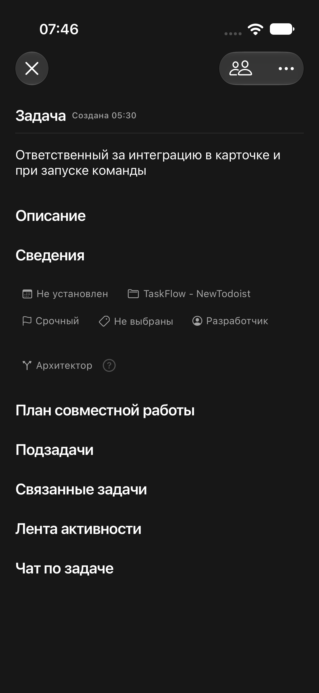

# Интеграция в стиле сведений

MAK-111. Вместо отдельного заголовка и синего Menu — значок ветки arrow.triangle.branch и выбранная роль. Шрифт, вторичный цвет, отступы совпадают с detailChip остальных сведений; Menu использует plain. Неброский ? оставлен рядом, название назначения доступно VoiceOver. Красный цвет сохраняется только при validationError. Сервер и правила выбора не менялись.

XcodeBuildMCP, iPhone Air iOS 27: сборка успешна, XCUITest 1/1 — раскрытие Сведений, открытие меню, выбор Архитектора, проверка выбранного значения, подсказка, возврат в Автоматически. Кадр визуально проверен: синий акцент отсутствует. Временный тест удалён. На физический iPhone не установлено.

