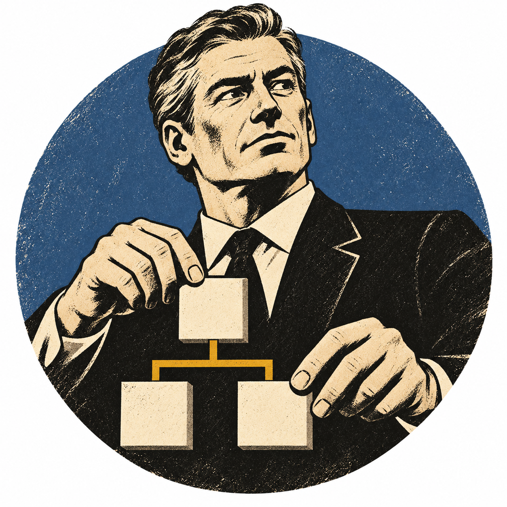

# Руководитель предыдущего комплекта

Linear MAK-110. Повтор текущего портрета в «Предыдущем» наборе заменён отдельным сгенерированным руководителем. Образцы: TeamPreviousArchitect, TeamPreviousAnalyst, TeamPreviousSecretary. Сохранены чёрно-кремовая графика старой печати, зернистость, матовый цветной круг и отсутствие надписей. Руководитель держит схему координации; фон приглушённый серо-синий.

Изменён только TeamPreviousOrchestrator/avatar.png. Существующий маппинг code_orchestrator/orchestrator → TeamPreviousOrchestrator сохранён. PNG и Contents.json проверены, изображение визуально сверено с тремя образцами. Повторная сборка и UI-тест для замены одного PNG не запускались. На физическом iPhone не установлено.

