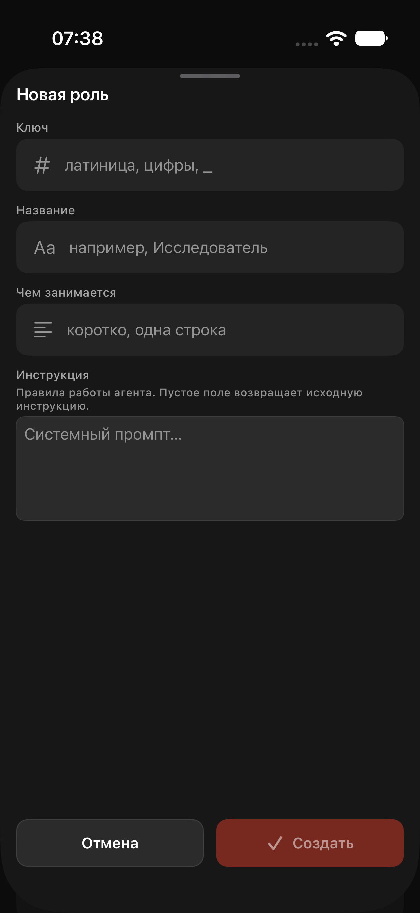

# Команда: единое меню действий

В «Команда» оставлена одна кнопка «…». Пункт «Добавить участника» перенесён туда рядом с «Внешний вид», отдельный плюс удалён. Пункт добавления доступен владельцу и открывает прежний RoleEditorSheet в режиме create. Отключение ролей не менялось.

Linear: MAK-109.

## Проверка

XcodeBuildMCP, iPhone Air iOS 27.0: сборка и временный XCUITest прошли (1/1). Проверены отсутствие отдельной кнопки «Новая роль», оба пункта меню, открытие прежней формы и закрытие через «Отмена». Роли тестом не создавались. Временный тест удалён после проверки, xcodegen обновлён. На физический iPhone не установлено.

