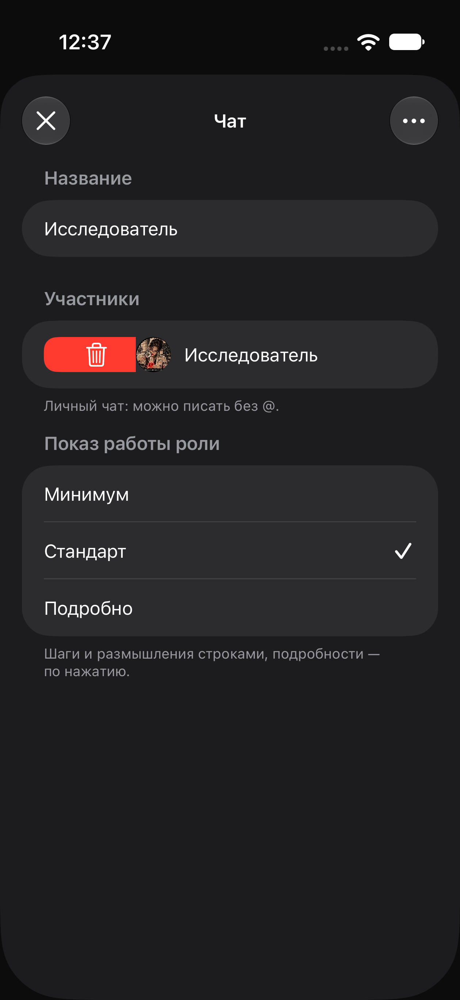

# Фирменный свайп участника чата — 16.10.2026 (не актуально)

По уточнению владельца использован существующий DirectorySwipeRow из списка проектов: свайп вправо открывает красную панель, нажатие корзины исключает участника. Новый жест не создавался. Пороги, ширина, пружина, тактильный отклик и реестр одной раскрытой строки остались общими.

В общий компонент добавлены необязательная правка и параметры иконки/подписи удаления. У существующих вызовов сохранились прежние настройки; в чате — только удаление с корзиной. Plain button style в Form предотвращает превращение всей строки участника в кнопку удаления. Непрозрачный фон содержимого закрывает панель в покое. Контекстное меню, права создателя и существующий серверный вызов удаления сохранены.

Проверка: целевой XCUITest открыл состав чата и свайпом раскрыл кнопку «Удалить из чата» в локальном preview. Тест прошёл; кадр просмотрен. Реальные участники не удалялись. Исходная попытка UI-теста не нашла кнопку шапки из-за переполненной DEBUG-панели; в специальном preview скрыты только лишние тестовые кнопки, производственная шапка не менялась.

Результат: `docs/2026-10-16-chat-member-swipe/verified.xcresult`. Кадр: `member-delete-swipe.png`. Временный XCUITest сохранён рядом с кадром. Скан оформления — без новых отклонений.

Владелец берёт проверку на iPhone на себя. Установка сборки отмечается отдельно по фактическому результату.

## Установка

Сборка для физического iPhone Air прошла: BUILD SUCCEEDED. devicectl подтвердил установку com.maksim.taskflow.native на устройство 00008150-001545400144401C. Это включает предыдущие подписи действий и подключения навыков. Физическую проверку свайпа выполняет владелец; успешная установка ею не считается.
