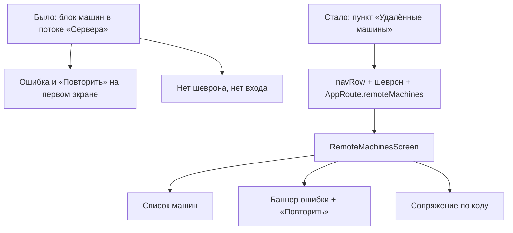

# Раздел «Сервер» → пункт «Удалённые машины» вместо блока в потоке

Дата: 16.10.2026. Строка реестра: `LOCK-REMOTE-MACHINES-ROW-20261016`.

## Что сказал владелец

Телефон, раздел «Сервер»:

> И вижу, мне удалось прочитать список машин и кнопочка «Повторить». Какие, блядь,
> машин? Чего за повторить, кого я тут повторю в разделе «Сервер»? Почему здесь
> нет раздела «Удаленный хост», куда я нажимаю, и вот потом выкатывается вот
> такая вот «не удалось прочитать список машин» и типа есть обновить.

## Причина

`RemoteMachinesSection` был вставлен прямо в поток карточки «Сервер» — без
заголовка, без шеврона и без перехода. Из-за этого:

- **загрузка и ошибка принадлежали списку настроек**, а не разделу машин —
  отсюда «какие машины?» в разделе «Сервер»;
- **«Повторить» не имел предмета** — рядом не было ничего, что можно повторить;
- **не было входа**: пункт нельзя было открыть, всё происходило сразу.

Остальные пункты секции устроены правильно: `navRow` с шевроном и переходом на
отдельный экран — «Параметры», «Перезапустить сервер», «Pi Runtime»,
«Сервер MCP». Машины были единственным исключением.

## Что сделано

| Файл | Что |
|---|---|
| `AppRoute.swift` | добавлен `case remoteMachines` |
| `RouteDestinationView.swift` | ветка `case .remoteMachines: RemoteMachinesScreen()` |
| `SettingsScreen.swift` | `RemoteMachinesSection()` заменён на `navRow(icon: "desktopcomputer", title: "Удалённые машины", route: .remoteMachines)` |
| `RemoteMachinesScreen.swift` (новый) | экран: шапка, список, ошибка, сопряжение, `MachineRow` |
| `RemoteMachinesModel.swift` (переименован) | остались `RemoteMachine`, `PairingCodeResponse`, `RemoteMachinesViewModel` |
| `RemoteMachinesUITests.swift` (удалён) | проверял уже несуществующий блок в потоке |
| `RemoteMachinesRowUITests.swift` (новый) | проверяет пункт, переход и экран |

Модель данных и логика не менялись — переехал только вид и место. Файл секции
разделён на два: `Model` (данные и вью-модель) и `Screen` (экран). Иначе в одном
файле оказались бы два определения `MachineRow` с разным видом — а правило
проекта «одна правка — одно место».

## Что на экране теперь

**Пункт в «Сервере»** — обычная строка с иконкой монитора и шевроном, рядом с
«Параметры», «Сервер MCP» и прочими. Никаких сообщений об ошибке.

**Экран «Удалённые машины»** — своя шапка «УДАЛЁННЫЕ МАШИНЫ», объяснение, что
такое машины-хосты, затем:

- список машин в карточке с индикатором связи и подписью (на связи / нет связи);
- кнопка «Подключить MacBook» (или «Сопрячь ещё одну машину»);
- при ошибке — баннер «Не удалось прочитать список машин» с иконкой и серая
  «Повторить» с тонкой рамкой.

## Проверка

- `Tools/ui-drift-scan.sh` → Отклонений нет, код 0.
- Сборка симулятора iPhone Air iOS 27.0 → **BUILD SUCCEEDED**
  (`.worktrees/_bg/build6.log`).
- `UITests/RemoteMachinesRowUITests` → **3/3 PASS**, xcresult
  `.worktrees/_bg/rmrow.xcresult`:
  - в «Сервере» есть пункт с шевроном и НЕТ кнопки «Повторить» в потоке;
  - по тапу открывается отдельный экран со своей шапкой;
  - состояние ошибки живёт на экране (баннер + «Повторить»).
- Три кадра в `docs/2026-10-16-remote-machines-row/`, просмотрены агентом:
  - `01-server-section-remote-machines-row.png` — пункт в ряду соседей, ошибки нет;
  - `02-remote-machines-screen.png` — экран машин;
  - `03-remote-machines-error-state.png` — баннер с иконкой, серая «Повторить»
    с рамкой, списка нет.

## Чего не делал

Не трогал сам текст «не удалось прочитать список машин» — он точен. Владелец
возражал не к формулировке, а к тому, что она появляется в разделе «Сервер».
Сообщение и «Повторить» теперь там, где им и место.
