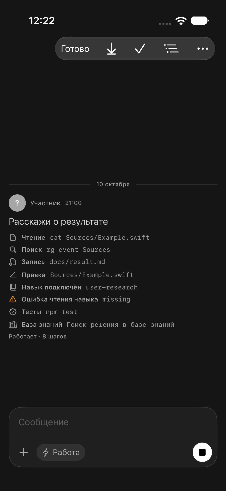
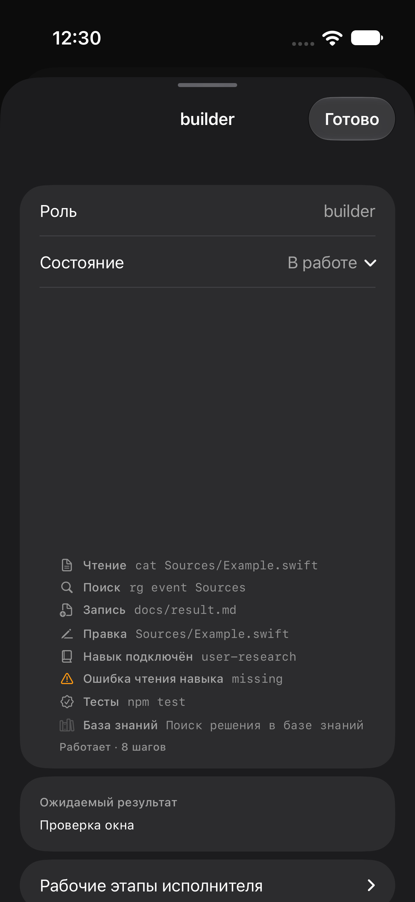

# Подписи действий и навыков роли — 16.10.2026

## Изменение

Общий компонент живого хода теперь различает чтение, запись, правку, поиск, папку, тесты, сборку, Git и веб-действия. Из инструментов TaskFlow отдельно подписаны база знаний, память, документация, комментарии и сдача результата. Оформление строк и существующие раскрываемые подробности сохранены.

Разбор команды ограничен понятными случаями. Неизвестные программы, shell-подстановки, heredoc и перенаправления сохраняют подпись «Команда». У составной команды могут быть несколько видов в подписи, например «Чтение · Поиск»; это один реальный вызов, отдельные статусы выполнения внутренних команд не выдумываются. Уже существующие отдельные события инструментов не объединяются. Режим «Минимум» по-прежнему скрывает действия по настройке пользователя.

Чтение пути `skills/<имя>/SKILL.md` отдельным инструментом read показывает «Подключение навыка», «Навык подключён» или «Ошибка чтения навыка». Наличие в каталоге, упоминание, запись файла и команда bash с таким путём не выдаются за применение. Эта отметка доказывает получение инструкции; выполнение всех её требований по ней утверждать нельзя.

Добавлен признак фактически полученного результата инструмента: остановка анимации через ending() не может превратить незавершённое чтение в подтверждённую загрузку. Детали и этот признак сохраняются в локальном архиве шкалы действий. Старый архив декодируется без новых полей.

Новая подсказка объясняет действие отметки и открытие подробностей. Есть тест завершения сценария подсказки.

## Границы

Изменён iOS-клиент в канонической папке на Mac. Сервер, настройки JEV и навыки ролей не изменены. Это не прибор учёта использования навыков и не доказательство результата реальной задачи.

Живой чат и окно работающей роли из графа используют один RoleLiveTurnBubble/RoleLiveItemsList. Изменение относится к этим структурированным событиям; старые текстовые записи activity без результата инструмента не объявляются подтверждённым подключением навыка.

## Проверки

Исходный вид воспроизведён XCUITest и снят в `docs/2026-10-16-role-action-labels/before.xcresult`: cat/rg/npm test подписаны одинаково, write объединён с edit, у навыка обычная подпись чтения.

Проверки после изменения и ограничения физического устройства дописаны ниже по фактическим результатам.

Фикстура использует настоящий компонент отображения и стандартную настройку детализации. В чате входные события поданы через DEBUG reading preview; в графе REST-карточка/план предоставлены существующим локальным `Tools/live-window-recheck-fixture.py`, а поток — DEBUG-снимком в настоящем TaskLiveActivityView. Проверка не является запуском живой модели и не выдаётся за проверку сервера.

Скан оформления: новых отклонений 0; девять прежних KNOWN не менялись. На устройстве: физический iPhone Air `00008150-001545400144401C` недоступен по devicectl; тест и установка на физический iPhone не выполнены.

## Подтверждённые результаты

- 46/46 юнит-тестов: 8 классификации и достоверности чтения навыка, 9 подсказок, 29 регрессий живого хода. `verified.xcresult`; UI-поднабор того запуска имел неудачный селектор графа, поэтому весь bundle имеет failed, несмотря на успешные юнит-тесты.
- Чат: XCUITest прошёл в `verified.xcresult`; видны все восемь видов действий фикстуры, различаются успешный навык и ошибка, по нажатию открывается исходный путь.
- Окно роли из графа: отдельный окончательный XCUITest прошёл в `graph-confirmed.xcresult`; проверены те же подписи, имя навыка, подробности. Промежуточные ошибки относились к навигации/селекторам теста. Иерархия показала наследование идентификатора DisclosureGroup внутренней ScrollView; исправлен тест, соседний UI не менялся.
- Итоговые кадры просмотрены: `chat-actions.png` и `graph-actions.png`. Настоящая физическая приёмка не выполнена: iPhone недоступен.
- Временный тест сохранён рядом с отчётом и удалён из UITests, проект перегенерирован.

Обычный запуск симулятора после тестов восстановлен без preview-переменных, CLI подтвердил запуск процесса. Физический iPhone не устанавливался.
