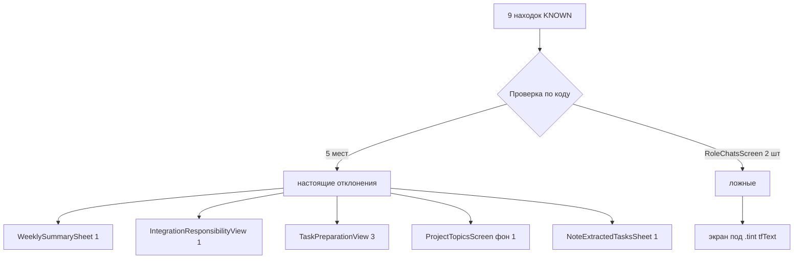

# Девять отклонений из KNOWN — закрыты одним проходом

Дата: 16.10.2026. Строка реестра: `LOCK-UI-DRIFT-KNOWN-20261016`.

## Что было

Скан `Tools/ui-drift-scan.sh` после работы над `LOCK-UI-DRIFT-GATE-20261016` держал
девять находок в `KNOWN` — отклонения, найденные, но лежащие вне строки
реестра. Владелец 16.10.2026: «заведи строку реестра на 9 оставшихся
отклонений — закрою одним проходом по шести файлам».

## Сколько оказалось настоящих

Пять. Две находки в `RoleChatsScreen` — ложные.

### Почему две в чате ложные

`RoleChatRoomScreen` несёт `.tint(Color.tfText)` в теле экрана (строка 832).
Обе кнопки — «Повторить отправку» у голосового и «Повторить» у неотправленного
текста — лежат внутри этого тела, поэтому системные кнопки там **серые**, а не
синие. Скан про `.tint` не знал и выдавал их за отклонения.

Проверено чтением кода, не на глаз: `.tint` на строке 832, обе кнопки на 1209 и
1414, тот же тип `RoleChatRoomScreen`. Файл не менялся — вместо этого в скан
добавлен список `TINTED_SCREENS`.

## Что сделано

| Файл | Что | Правка |
|---|---|---|
| `ProjectTopicsScreen.swift` | корневой `List` без фона | `.tfScreenBackground()` |
| `WeeklySummarySheet.swift` | системная «Повторить», текст ошибки | `TFErrorBanner(.block)` + `TFButton(.secondary)` |
| `IntegrationResponsibilityView.swift` | системная «Повторить», текст ошибки | `TFErrorBanner(.block)` + `TFButton(.secondary)` |
| `TaskPreparationView.swift` | три системные кнопки | `TFButton(.secondary)`, заголовок и текст ошибки оставлены |
| `NoteExtractedTasksSheet.swift` | `TFButton` без `variant:` | `variant: .primary` проставлен явно |
| `RoleChatsScreen.swift` | — | **не менялся**: находки ложные |

Иконка `arrow.clockwise` на кнопках повтора — тот же приём, что в
`RemoteMachinesSection` (эталон 16.10.2026), чтобы одинаковое действие
выглядело одинаково везде.

### Два решения, о которых стоит знать

**В `TaskPreparationView` текст ошибки оставлен как есть.** Там не баннер
ошибки, а состояние целого экрана: заголовок «Не удалось загрузить подготовку»
плюс пояснение. Оборачивать это в `TFErrorBanner` значило бы дублировать
заголовок внутри баннера. Поменяно только действие.

**В `NoteExtractedTasksSheet` красный оставлен.** «Создать» — подтверждение
действия, тот же образец, что «Сохранить» в `EditProfileSheet` и
`TemplatesScreen`. Проставлен явный `variant: .primary`, чтобы скан отличал
подтверждение от действия по умолчанию.

## Второй урок про скан

Первая находка из `RoleChatsScreen` оказалась ложной — и это **второй класс
пропуска** после системных диалогов:

| Класс | Что скан не знал | Как закрыт |
|---|---|---|
| Диалог | кнопка внутри `.alert` красится системой | `in_system_dialog()` |
| Тинированный экран | `.tint(Color.tfText)` перекрашивает системные кнопки | список `TINTED_SCREENS` |

Скан честно выдаёт `Отклонений нет` — но только потому, что оба класса
закрыты. Новый класс потребует такой же правки, а не молчаливого пропуска.

## Проверка

- `Tools/ui-drift-scan.sh` → **Отклонений нет**, код возврата 0.
- Сборка симулятора iPhone Air iOS 27.0 → **BUILD SUCCEEDED**
  (`.worktrees/_bg/build5.log`).
- `Tests/UIStyleGateTests` → 9/9 PASS (`.worktrees/_bg/stylegate7.xcresult`).
- `RoleChatsScreen.swift` в `git diff` отсутствует — там нечего было менять.
