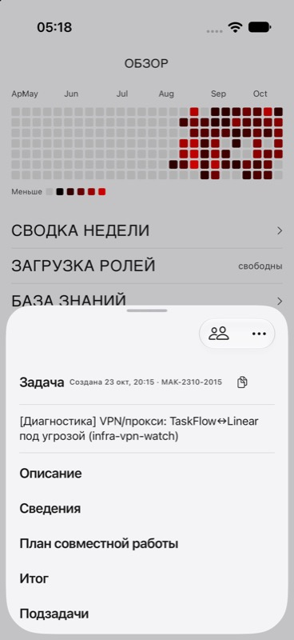

# Копирование номера задачи — 24.10.2026

В заголовок карточки рядом с номером добавлена иконка копирования. Действие записывает только номер задачи в системный буфер обмена. Добавлены accessibility label/id и подсказка.

Проверка: сборка симулятора успешна; design-system-guard по изменениям чистый; кадр визуально проверен. Кнопка находится справа от номера в той же строке. Содержимое буфера отдельно не проверялось.

По прямому указанию владельца UI-тесты не писались и не запускались. В AGENT-CYCLE.md, AGENTS.md, CLAUDE.md и навыке ios-ui-triage закреплено: для всех агентов UI-тесты только после явного согласия владельца; по умолчанию сборка и скриншот. Старое автоматическое исключение для Codex отменено.
