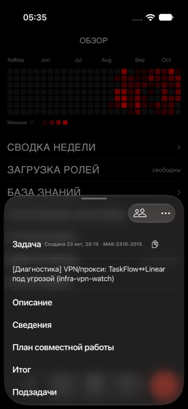

# Системная поверхность карточки задачи

Причина чёрной карточки: собственный presentationBackground, непрозрачный фон TaskCardContent, строки списка и две подложки TaskFormScreen в TaskFamilyNavigation закрывали системную поверхность.

Удалены заливки шторки и корневых контейнеров; строки списка прозрачны. Поверхности выдвигаемых соседних задач используют системный background, элементы переключения — systemBackground вместо общего чёрного токена. Развёрнутые формы создания используют общий taskCardSheetPresentation. Главный фон приложения остаётся чисто чёрным.

Проверка: design-system-guard и diff --check чистые; сборка симулятора успешна. На кадре iPhone Air в тёмной теме карточка имеет системную поверхность и отличается от чёрного экрана, между видимыми секциями полос нет. Клавиатура, переключение семейства и физический iPhone отдельно не проверялись. UI-тесты не писались и не запускались.

